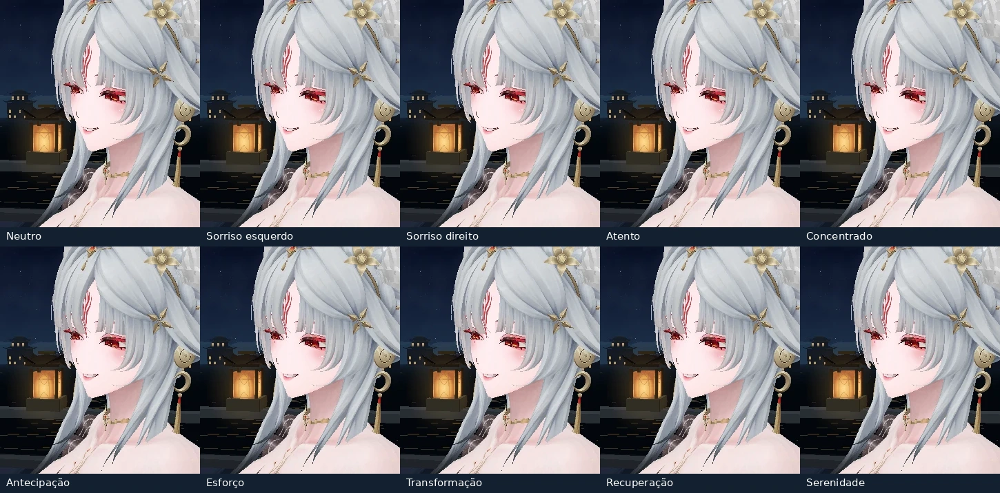

## Receitas de ensaio

Pesos abaixo são overlays experimentais de entrada para o binding. O neutro restaura o snapshot por submalha, inclusive valores exportados não nulos. B indica sobrancelha/testa, E pálpebra, P_Nose nariz e M boca/cantos. Pupilas usam os vetores de calibração do perfil. Bochecha, abertura mandibular e linha labial independente carecem de canal isolado demonstrado. A assimetria vem dos pares L/R e requer conferência no lado anatômico da personagem.

| Leitura candidata | Sinal e pico proposto | Entrada / sustentação / saída (s, autoria local) |
|---|---|---|
| Neutro | overlay zero, gaze zero | 0,25 / livre / 0,25 |
| Sorriso esquerdo | smileL 0,10 | 0,30 / 0,45 / 0,35 |
| Sorriso direito | smileR 0,10 | 0,30 / 0,45 / 0,35 |
| Atento | B_Up_Add bilateral 0,05 | 0,20 / 0,40 / 0,30 |
| Concentrado | E_Squint bilateral 0,04 | 0,25 / 0,45 / 0,30 |
| Antecipação | B_Up_Add_R 0,06 e E_Squint_L 0,03 | 0,20 / 0,15 / 0,25 |
| Esforço | E_Squint bilateral 0,05 e M_Squint bilateral 0,04 | 0,12 / 0,12 / 0,22 |
| Transformação | B_Up_Add bilateral 0,07 e gaze vertical calibrado 0,08 | 0,35 / 0,30 / 0,40 |
| Recuperação | reduzir overlays ativos até zero | 0,35 / 0,25 / 0,25 |
| Serenidade | smile bilateral 0,04 e E_Smile bilateral 0,03 | 0,45 / 0,70 / 0,45 |

Somente o árbitro controla blink/close. A ligação atenua E_Smile/E_Squint por (1−close)². Nunca somar receitas, opor P_Nose_Up/Down ou conduzir pupila bruta junto com gaze. Evitar o bypass authored/diagnostic em combate. Preservar os mesmos materiais, alpha do olho, normais-base e a substituição Lambert da pele. Conferir clipping e simetria com blink ativo e em retorno ao snapshot. Ver docs/hsin-v201-material-audit.json e docs/qa/hsin-v201/face-before-after.webp para o controle de iluminação.

A prancha usa a rasterização CPU do projeto, o snapshot do GLB, o binding público em política B.1 e o eixo vertical calibrado. Recuperação mostra o último quadro, idêntico ao neutro. A diferença dos cantos labiais é pequena nesse ângulo; o cabelo encobre parte da sobrancelha. Os quadros servem à comparação de geometria. O Chromium local encerrou antes de criar o contexto WebGL por restrição de socket. A luz de pele e o alpha finais devem ser conferidos no harness WebGL do repositório.
