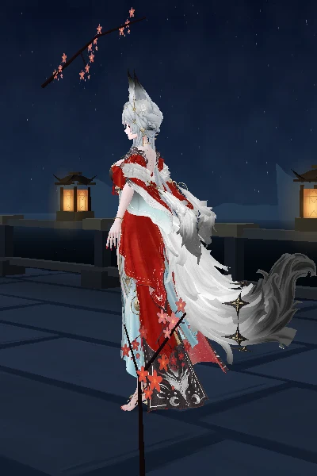

# Hsin · Cinematic Combat R1

Base main verificada em 07/11/2026: 13444422ea811bf7d4ca1d99c3e56a19dbe05f8e. Preflight incorporado do PR #268, árvore idêntica à candidata auditada. Branch experiment/hsin-combat-r1-20261107. A rota experimental é /experimentos/combate/. O botão Carregar combate busca o módulo e o bake sob demanda, depois Executar reproduz o ciclo. A câmera começa livre; Câmera automática ativa o plano e o próximo gesto manual devolve o controle ao visitante. A pausa do palco congela toda a cena; Pausar / retomar no painel congela o combate. O painel permite reiniciar com recuperação, interromper e baixar trace.

## Habilidades e fonte

| Bloco | Implementação | Relação com o jogo |
|---|---|---|
| Prontidão / preparação | 0–1,30 s. Braço dominante prepara, outro equilibra, tronco e cabeça contra-rotacionam | Autoria experimental. A prontidão é atingida em 0,70 s; os pés ficam plantados. A transferência de peso foi reduzida a uma antecipação de tronco. |
| Basic | 1,30–2,20 s. Extensão do braço e arco carmim/marfim em 1,65 s | Vocabulário do arco observado no vídeo em 49–52 s; a identificação como Basic e o timing deste bake são escolhas locais. |
| Skill | 2,20–3,85 s. Nova preparação, palma elevada e um anel âmbar em 3,35 s | Palma iluminada em 54–55 s informa o gesto. Um anel e sua trajetória são adaptação local, sem equivalência exata de skill declarada. |
| Recovery | 3,85–5,80 s. Retorno contínuo à referência cinematográfica | Autoria experimental. Limpa efeitos, reduz atuação facial e libera o corpo para idle. |
| Enhanced Heavy | Indisponível | Sem referência inequívoca. HEAVY existe no vocabulário do sequenciador e não entra no ciclo. |
| Formshift, Illumining, Dominion, Finisher, Return | Indisponíveis no contrato de formas | Sem placeholders de mecanismos, raposa ou Liberações. |

A referência autorizada contém cortes e ataques de equipe. Não há clipes originais no GLB. O estado SOURCE_FIDELITY_PASS canônico permanece pendente. [Vídeo de referência](https://x.com/yosp/status/2095346086382866654)

## Movimento e ownership

scripts/bake-hsin-combat-r1.mjs gera 175 amostras a 30 Hz. O bake usa nomes, baseline cinematográfica e transformação mundo → local separada para ORG e DEF. O delta mundial do driver é aplicado à referência mundial do deformer antes da conversão pelo pai correspondente. Flexão de cotovelo/punho usa o eixo da trajetória Signature/Chest já existente. Root, Pelvis, pernas e pés conservam a referência. Cabeça e tronco têm amplitudes discretas. Dados são int16 normalizados, e as duas extremidades usam os quaternions originais exatos.

O grupo secundário reaproveita nomes/eixos/gain/depth da R3 para cabelo, mangas e cauda. O atraso por profundidade e a resposta ao giro do tronco são calculados offline. Ornamentos seguem seus pais e a malha original. A simulação não inclui cloth ou IK em runtime.

O laboratório recusa entrada durante a posse da dança ou um gesto de idle. Solicita que o idle retorne e o visitante executa novamente quando estiver pronto. Na aquisição, body.reset remove respiração/gestos e o laboratório verifica a referência local de cada canal. Enquanto o combate possui o corpo, o palco pula os diretores de idle e dança. O player escreve cada quaternion uma vez. A recuperação interrompida captura a pose corrente e usa uma curva quintic de 0,65 s antes de restaurar o snapshot. Reiniciar solicita essa recuperação antes do novo ciclo. A máquina tem relógio único, trace limitado a 2.048 entradas e deduplicação de eventos por cruzamento de marcador. O laboratório usa o loop de 30 FPS já existente.

## Facial, efeitos e câmera

A atuação gera overlays pequenos para E_Squint bilateral, B_Up_Add_R e M_Squint bilateral. A aplicação final continua em createFaceBinding, após o árbitro ocular original. O combate preserva blink e gaze. Marcadores de estado selecionam a receita, com redução durante Recovery. Ao liberar, o rosto contemplativo volta ao diretor existente. Material e iluminação de pele permanecem no pipeline do palco.

VFX possuem duas geometrias e dois materiais, zero texturas e zero passes extras. O toro usa drawRange parcial no arco e completo no anel. O pulso de preparação acompanha a mão; release fixa a origem em mundo, com direção do modelo. A expansão de impacto é breve e o envelope dissipa os slots. Nenhum recurso é alocado por golpe. O dono dos recursos é o módulo de laboratório; dispose remove o grupo e libera suas geometrias e materiais uma vez.

Planos disponíveis por fase: Combat Wide / preparação, Action Follow / Basic, Skill Detail / Skill e Recovery. A R1 mantém plano inteiro e só ajusta levemente o alvo na Skill; a aproximação maior aguarda revisão de oclusão. Câmera automática é opt-in, amortecida por dt. Pointerdown, roda, OrbitControls.start e controles de zoom retiram a posse automática. Pan é habilitado só no laboratório e seu valor anterior é restaurado ao sair. Não há shake. O pavilhão, a lua e o cenário são reutilizados. A rota de laboratório omite o widget musical para abrir a área inferior de ação.

## QA e medições

| Gate | Resultado |
|---|---|
| BUILD_PASS | PASS local, Astro e build hygiene |
| RIG_PASS | PASS estrutural, identidade dos assets, nomes únicos, root/pelvis e restituição |
| GEOMETRY_PASS | PARCIAL. Apoio dos pés e continuidade angular passaram. Penetração de mangas/cabelo/torso e leitura de silhueta exigem revisão visual contínua e testes adicionais de superfície. |
| SOURCE_FIDELITY_PASS | PENDENTE para equivalência canônica. Proveniência autoral registrada. |
| VISUAL_QA_PASS | PENDENTE. Quadros e vídeo CPU do GLB, sem prova WebGL de materiais, VFX, câmera ou suavidade. |
| MOBILE_PASS | PENDENTE. Nenhuma sessão física em Samsung foi executada. |

structural-qa.json registra a sessão determinística de 600 s, apoio em 412 vértices, zero deslizamento medido, passo angular máximo de 3,66° e custo do sequenciador isolado em Node. lab-qa.json registra preparação e último custo CPU de integração em Node com cena Three.js e controles simulados. Esses valores não medem GPU nem rede. Bake de 466.403 bytes, buffer de quaternions decodificado de 663.600 bytes, recuperação de 7.584 bytes. Efeitos acrescentam no máximo duas draw calls quando anel e impacto coexistem; isso deriva da estrutura, ainda sem medição WebGL. Parse, compilação, primeira imagem e custo incremental no aparelho precisam do preview funcional com ?hsin-metrics.

Foram testados manualmente por eventos simulados os controles de executar, pausa/retomada, restart, takeover e stop, mais descarte idempotente. Passaram os testes de paridade do rig, Lip/Hair, diretor R3, pele, playback de atuação e instrumentação do palco. A tentativa de preview gerenciado falhou porque o comando Astro iniciou um servidor em background e o processo acompanhado encerrou. Não houve verificação de navegador nesta rodada.

## Evidência do GLB

combat-cpu.mp4 mostra o movimento contínuo a 10 amostras/s, no mesmo enquadramento. A rasterização CPU não inclui os VFX do runtime nem a resposta final de luz da pele. Gerar com render-hsin-poster.mjs usando --dance=idle --combat=1 --time=SEGUNDOS; adicionar --detail=1 para close. O vídeo serve à revisão do corpo.

## Próxima entrega

1. Revisar a sequência no preview em paisagem e 390×640, com zoom, rotação, pan, interrupção e contexto perdido. Medir custo incremental, frame-time e recursos ao longo de dez ciclos e 600 s em Samsung.
2. Obter tomadas de gameplay 3.7 com inputs ou legendas para Basic, Skill e Enhanced Heavy. Confrontar início, impacto e recuperação com o bake, e aprovar ou corrigir a coreografia.
3. Para Formshift, obter referência contínua de entrada/saída e aparência autorizada da Forma Iluminante. Manter resources separados por forma e adicionar somente essa transição com devolução determinística.
4. Introduzir mecanismos como atores ancorados em mundo, validar geração/colapso e o contrato de Coração Iluminante. Implementar Dominion após esses contratos passarem.
5. Tratar a primeira Liberation como transformação com continuidade corporal. Implementar a segunda, Pilares Através dos Céus, após validar domínio, finalizador e retorno à Forma Responsiva. Cada fase precisa de cancelamento, câmera e orçamento próprios.
