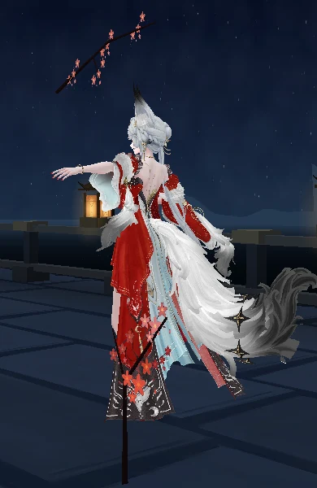

# Hsin Combat R2 · referência audiovisual e reconstrução

Base remota verificada: PR #269, a88d447fcc8b9cec05143367d79f6e31939b6251. main permaneceu em 13444422ea811bf7d4ca1d99c3e56a19dbe05f8e na seleção da base. O preflight #268 já integra essa árvore.

A R2 amplia o ciclo de 5,8 para 8,4 s, com dois golpes alternados, participação do quadril, pernas resolvidas offline e emissão por anel com rastros e ecos. É uma reconstrução autoral apoiada nas referências do usuário. R1 permanece selecionável antes do carregamento no laboratório /experimentos/combate/. Para trocar depois do carregamento, recarregar a página. A rota pública da Hsin conserva seu comportamento.

## Material analisado

O [catálogo dos 16 arquivos](reference-analysis/source-catalog.md) descreve cada movimento importante observado, com nomes originais e pranchas. O pacote tem manifesto, metadados, timeline revisada, candidatos automáticos a cortes, mapa corporal, mapa facial, paleta temporal e planos de câmera.

Reproduzir ingestão com Node, FFmpeg/FFprobe e Python para ZIP:
`node scripts/analyze-hsin-references.mjs CAMINHO_DO_ZIP_OU_PASTA SAIDA_PRIVADA`.
A ferramenta preserva os originais e gera derivados. Para OCR opcional do showcase, usar
`node scripts/classify-hsin-captions.mjs VIDEO SOURCE_ID SAIDA_JSON`, com Tesseract instalado.
A ingestão escreve automatic-cut-candidates.csv e preserva timeline.csv revisada. O teste usa um vídeo sintético com corte e trechos estáticos.

## Implementação

253 canais locais quaternion, incluindo os 215 secundários da R3 e as cadeias inferiores ORG/DEF. O container do esqueleto é o único dono da translação. O bake usa o solver de apoio da Dance R2, com deslocamentos de quadril até 60 mm e abaixamento até 60 mm. Arquivo principal de 1.457.955 bytes, incluindo a lattice de recuperação. Quaternions decodificados ocupam aproximadamente 2.125.200 bytes. As strings base64 são removidas depois da decodificação. Não há IK em runtime.

Na recuperação, somente a lattice escreve as pernas; os demais canais interpolam para a referência. A aquisição verifica quaternions e posição de suporte. Uma solicitação durante dança é recusada antes de tocar no idle. O reinício recebe ticks também enquanto aguarda readquirir o corpo, e Stop cancela a fila de restart.

A face usa esforço discreto em E_Squint/M_Squint bilateral, preparação em B_Up_Add_R e sorriso assimétrico pequeno no marco do anel. Receitas permanecem no binding público, com blink/gaze originais. Recovery/Interrupted conservam a receita corrente e reduzem seu ganho, evitando o corte abrupto da expressão. Os renders faciais CPU demonstram a deformação, sem validar iluminação final. A leitura de esforço permanece parcial porque o repouso labial já é sorridente; facial-comparison.md registra essa limitação.

O pool possui toro completo, toro parcial de arco, impacto e trilha de 16 pontos. Dois ecos compartilham a geometria completa. São até cinco draws adicionais no pico da R2, quatro geometrias e três materiais, zero texturas ou render targets adicionais. A R1 usa três geometrias devido à correção do arco parcial; a trilha só é alocada na R2. As contagens são derivadas da estrutura Three.js, não uma medição GPU.

O arco parcial usa o quinto argumento de TorusGeometry. O drawRange antigo cortava a seção radial sem remover uma parte da circunferência. A câmera acompanha o quadril e varia suavemente entre planos inteiros; durante Recovery aproxima a vista guardada ao ativar a automação. Entrada manual cancela a posse automática. OrbitControls, pan, zoom, DPR adaptativo e loop único do palco continuam em uso.

## QA

| Gate | Estado |
|---|---|
| BUILD_PASS | PASS local, build e hygiene |
| RIG_PASS | PASS estrutural, aquisição/restauração, canais e suporte |
| GEOMETRY_PASS | PARCIAL. 412 vértices de apoio, máximo 0,054 mm no ciclo e 0,308 mm na recuperação. As sondas de triângulos do antebraço esquerdo não invadiram o rosto nas vistas 390×640 e 1280×720, incluindo perfil. Penetração de tecidos e leitura de silhueta exigem revisão adicional. |
| SOURCE_FIDELITY_PASS | PARCIAL. A família Basic agora possui referência legendada. Timing, amplitudes e Skill da candidata seguem autorais. |
| VISUAL_QA_PASS | PENDENTE. Imagens e vídeo CPU do GLB, sem validação final de VFX/iluminação. |
| MOBILE_PASS | PENDENTE. Sem sessão física Samsung. |

A sessão determinística de 600 s usa 18.000 frames e cobre pausa, retomada e interrupções. Passo angular máximo 6,09°. structural-qa.json contém custo isolado do sequenciador em Node. lab-qa.json contém teste integrado em Three.js com controles simulados, sem render. Os testes cobrem R1/R2, reinício através da mesma condição de ticks do palco, retomada manual da câmera, prioridade da dança, fade facial, cancelamento da fila e descarte idempotente.

A auditoria posterior Astra inspecionou a estrutura e mediu independentemente 505 fases de interrupção × 25 pontos, com máximo de 0,312 mm nas articulações DEF dos pés/dedos. Encontrou problemas no restart, recorte do arco, aquisição durante dança, fade facial e sobrescrita da timeline; esses pontos foram corrigidos e receberam verificação específica. A medida independente cobre as articulações, enquanto o teste local usa vértices de sola. A auditoria não aprova aparência ou dispositivo.

Os recursos e a privacidade da Shorekeeper ficam fora deste diff. O preview protegido continuou sem autorização de navegação nesta rodada; nenhuma alteração de Access foi feita.

## Evidências

combat-r2-cpu.mp4 apresenta a sequência contínua a 10 amostras/s. Esse rasterizador inclui a geometria deformada, mas não os VFX e a iluminação WebGL finais.

O plano de execução e as lacunas da próxima forma estão no [storyboard](reference-analysis/combat-storyboard.md) e no [registro de confiança](reference-analysis/confidence-and-gaps.md). Heavy e transformações permanecem indisponíveis até seus gates específicos.
