# Catálogo dos 16 arquivos

Identificações feitas nas pranchas temporais. Os nomes originais e hashes completos estão no manifesto. A confiança se refere à leitura do material, sem converter pixels em ângulos de rig.

## HSIN DANCING IS SO ELEGANT #wuwa #wuwacreator #wutheringwaves #fyp #kurogames #wuwaprev37.mp4

Duração do arquivo 16.997 s. Identificador hsin-7751533624ea.

Dança / idle performático. elevação alternada dos braços; espiral do tronco; reverência; abertura e giro; retorno e pulso vermelho ao final. Plano varia e aproxima. Útil ao atraso de mãos e mangas; não estabelece uma rotação de combate.

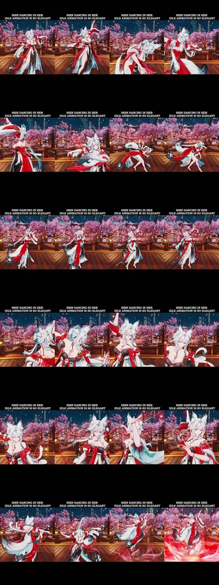

## HSIN-got-2-Expressions-for-THIS-wutheringwaves-wuwa_002_1440p.mp4

Duração do arquivo 6.223 s. Identificador hsin-16eda9d91cef.

Duas saídas da raposa. corte compara mão perto da boca com gesto de afastamento; punho relaxa; olhos semicerram e aparece sorriso. Comparação editada em blocos. Corpo da raposa não existe no GLB atual.

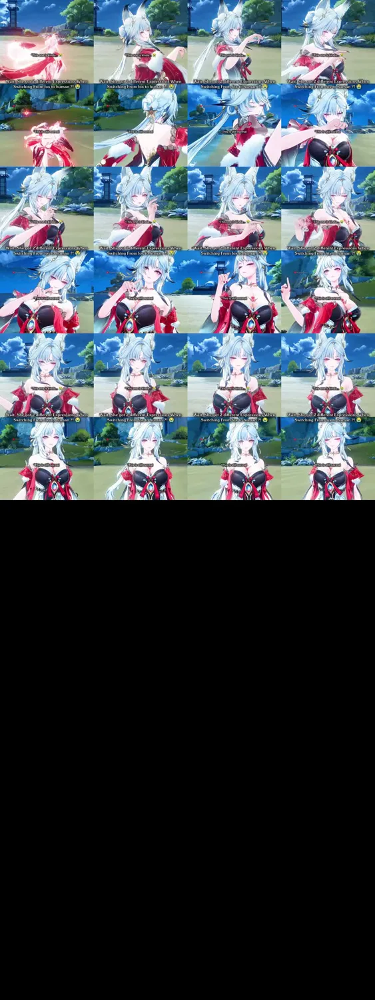

## Hsin-All-Skill-SFX-Showcase-Wuthering-Waves_002_1440p.mp4

Duração do arquivo 103.050 s. Identificador hsin-5679446ce7b6.

Showcase de habilidades. básicos vermelhos, mecanismos dourados, dash da habilidade, forte, raposa, pilares, intro e outro. Legendas editoriais identificam famílias. Sequências reiniciam e alternam formas.

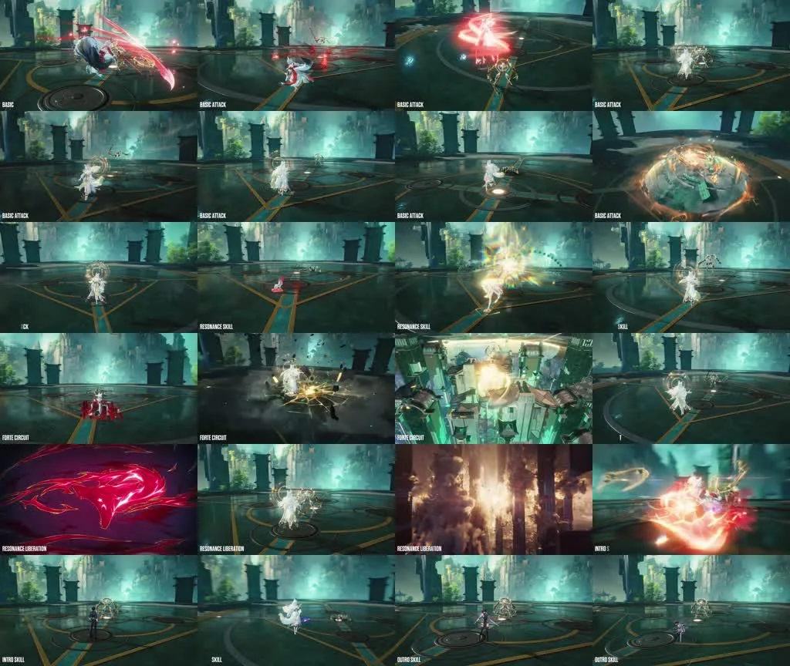

## Hsin-Feels-different-elegant-ultimate-idle-animation_002_1440p.mp4

Duração do arquivo 33.785 s. Identificador hsin-eecb85541a28.

Idle da forma dourada. braços comandam um mecanismo circular dourado; abertura dos braços; mecanismo acompanha e gira; retorno. Movimento contínuo de idle, com câmera orbitando e aproximando.

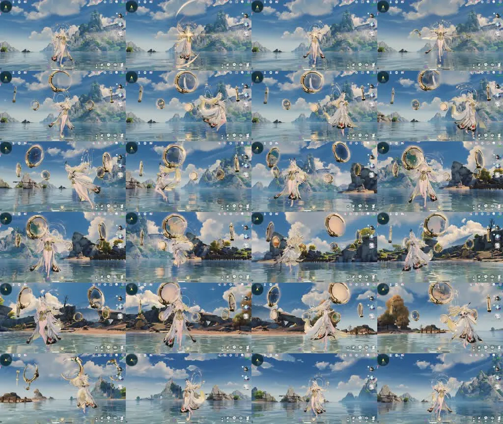

## Hsin-Suoming-Idle-Animations-Character-Screen_003_1080p.mp4

Duração do arquivo 295.822 s. Identificador hsin-cdfc7564ab1c.

Tela de personagens e idles. Hsin aproxima mão do rosto, invoca arranjo de pilares vermelhos, dança e apresenta mecanismo dourado; depois Suoming. Quase cinco minutos. Excluir a metade com personagem de cabelo vermelho do retarget Hsin.

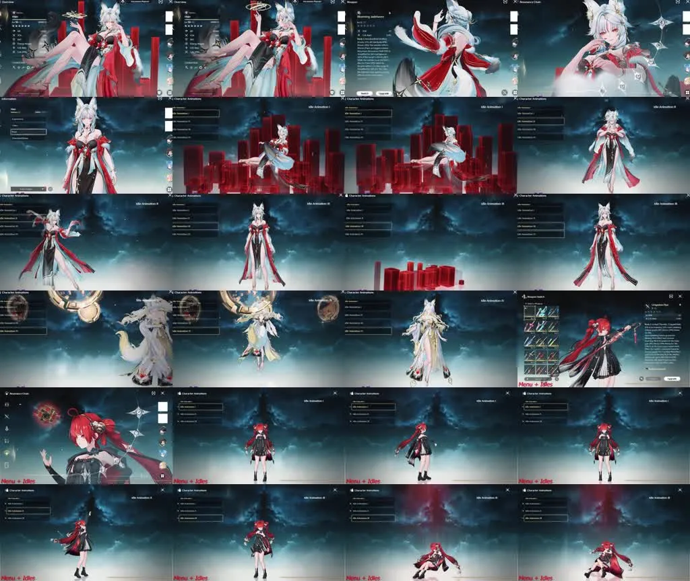

## Hsin-Unison-Rotation-Guide_002_1080p.mp4

Duração do arquivo 114.498 s. Identificador hsin-6f4bfc8b4a13.

Guia de rotação Uníssono. trocas Shorekeeper → Suoming → Hsin; básico, pesado, primeira Liberation; mecanismos e segunda Liberation; repetição. Legenda dos inputs ajuda a ordem, mas cortes, efeitos de equipe e trechos repetidos impedem atribuição direta de cada deslocamento.

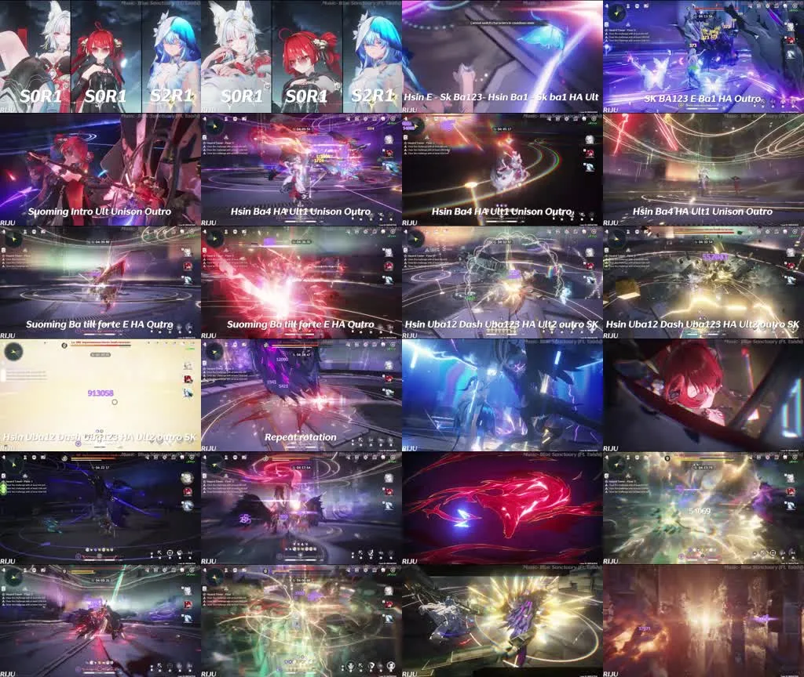

## Hsin-has-arrived-in-Mengzhou-in-style-beautiful-idle-animation_003_1080p.mp4

Duração do arquivo 33.855 s. Identificador hsin-641a241b8f96.

Idle com pilares vermelhos. estrutura de mecanismos cresce ao redor do corpo; senta/acomoda-se sobre apoio; gesto de mão; retorna a ficar em pé. Pilares vermelhos de apresentação. Não tratar como Pilares Através dos Céus em combate.

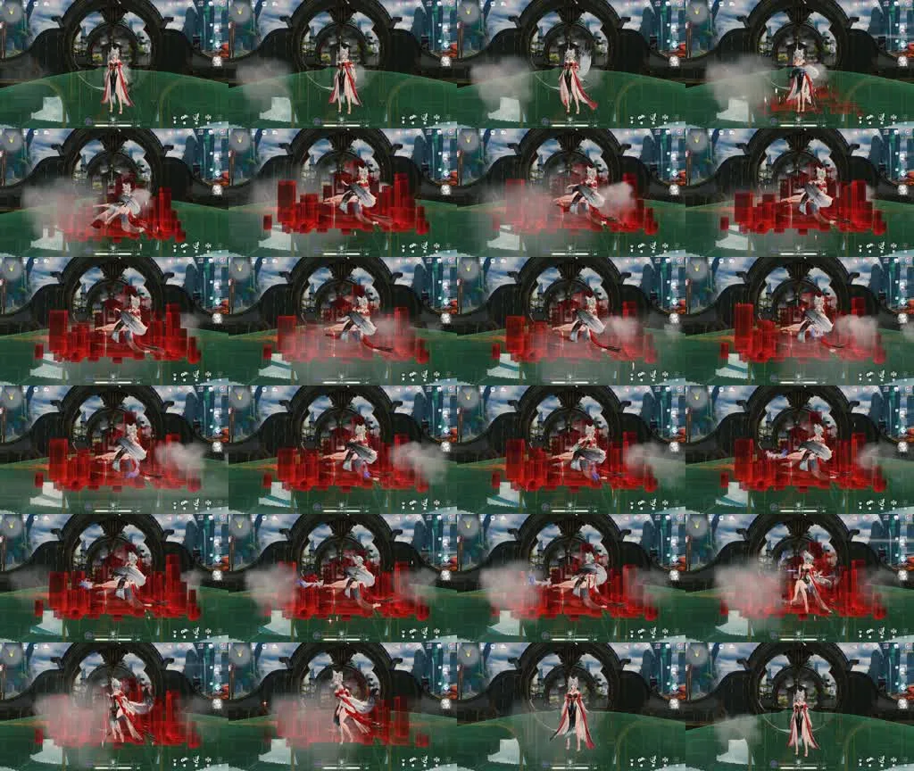

## Hsin-s-Expression-Is-So-Wuthering-Waves-shorts_002_1440p.mp4

Duração do arquivo 10.588 s. Identificador hsin-8491dd35cda0.

Close narrativo de expressão. plano dourado de costas, detalhe da mão, close frontal, mão perto da testa e abertura lenta das pálpebras. Montagem com cortes. A mudança de expressão pode depender de luz e sombra.

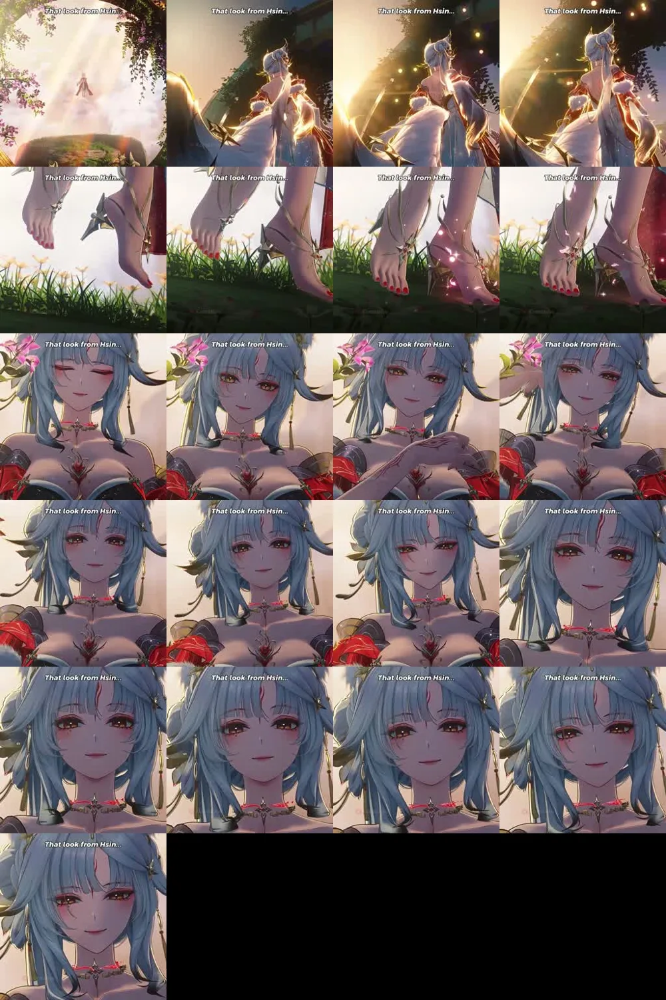

## hsin-cry-hsin.gif

Duração do arquivo 4.340 s. Identificador hsin-a50f15714983.

Reação facial. olhos abertos, boca entreaberta, pálpebras e cabeça descem; fechamento dos olhos no final. Nome cry não comprova lágrimas nem emoção. Falta morph de abertura mandibular independente.

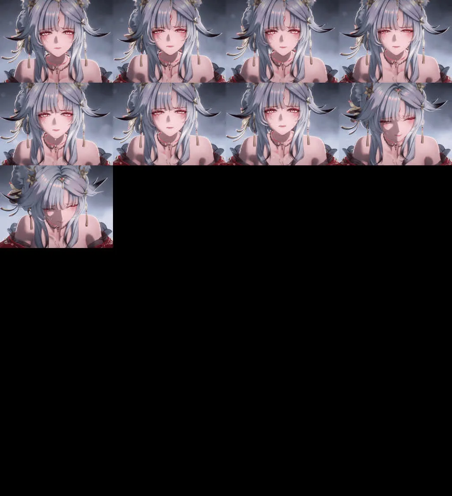

## hsin-stare.gif

Duração do arquivo 4.020 s. Identificador hsin-1f7f1b3d01d0.

Olhar lateral. cabeça ligeiramente baixa, olhar de lado; mão diante da face; pequeno movimento das pálpebras. Pose parcial de tronco. Duração do GIF não prova timing original.

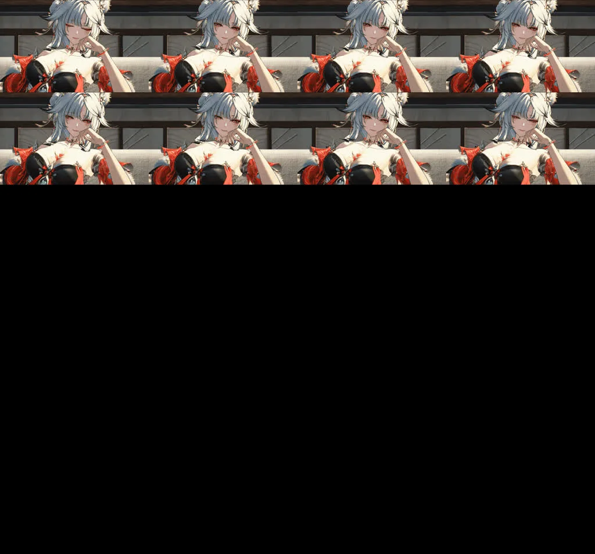

## hsin-wuthering-waves.gif

Duração do arquivo 3.840 s. Identificador hsin-11c2edbbc6a5.

Close dourado A. cabeça inclina, pálpebras baixam e abrem; olhar acompanha, canto labial discreto. Recorte cinematográfico. Comparar com close dourado B sem declarar equivalência exata.

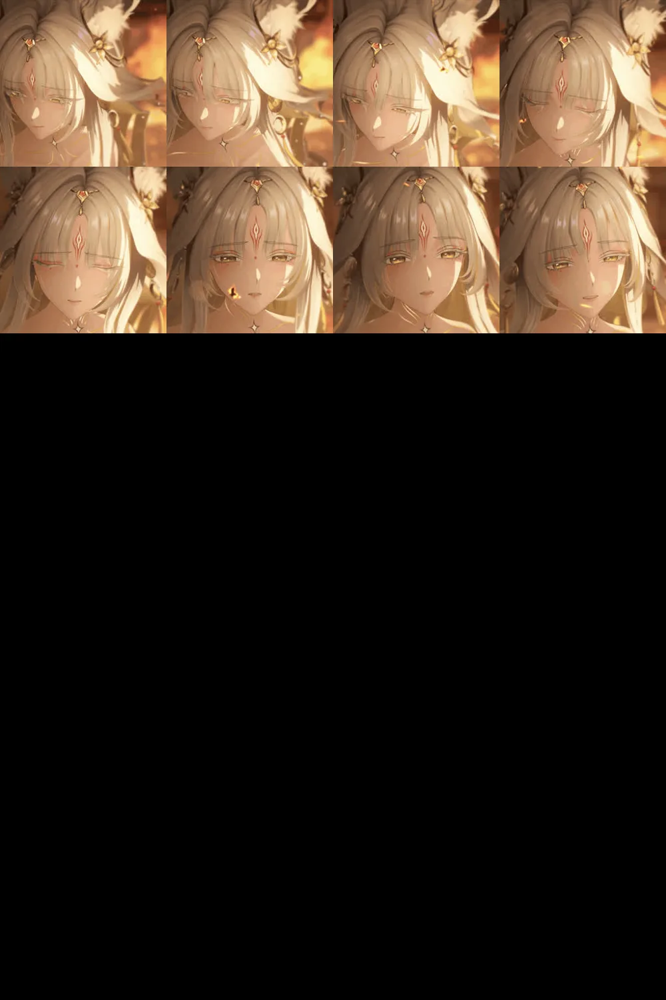

## hsin-wuwa(1).gif

Duração do arquivo 4.040 s. Identificador hsin-369c50bf6ac7.

Geometria dourada. close do corpo seguido de construções/linhas douradas; mãos comandam o efeito; câmera muda de distância. Efeito e câmera dominam a leitura; o root real fica ambíguo.

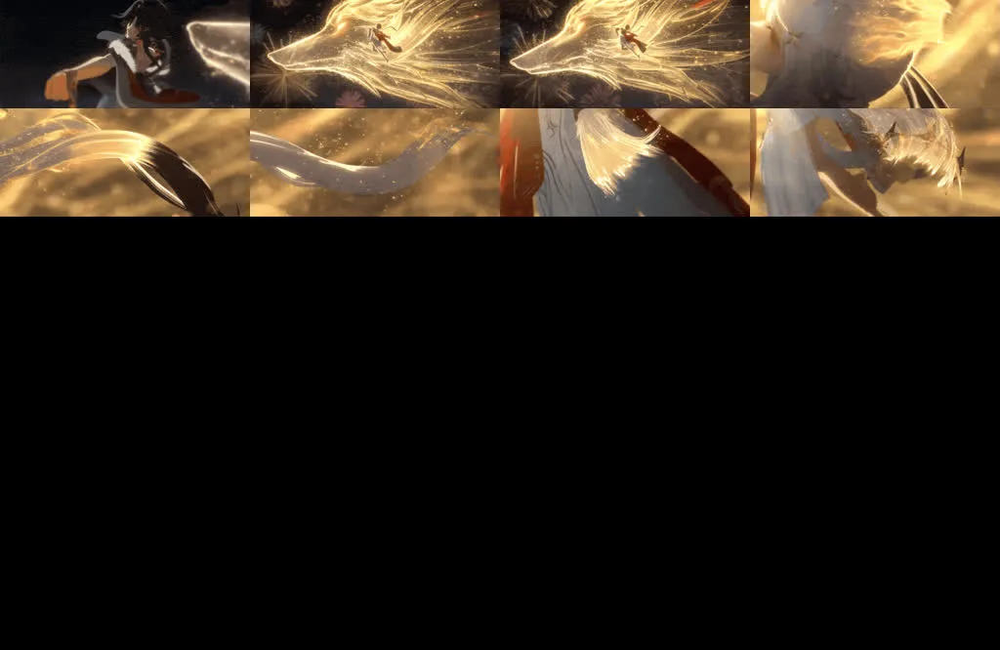

## hsin-wuwa.gif

Duração do arquivo 5.450 s. Identificador hsin-6f98cf177efa.

Close dourado B. mesma família de close; olhos fecham e reabrem; cabeça baixa e estabiliza. Trecho de comprimento diferente. Pode sobrepor o close A; não é duplicata por hash.

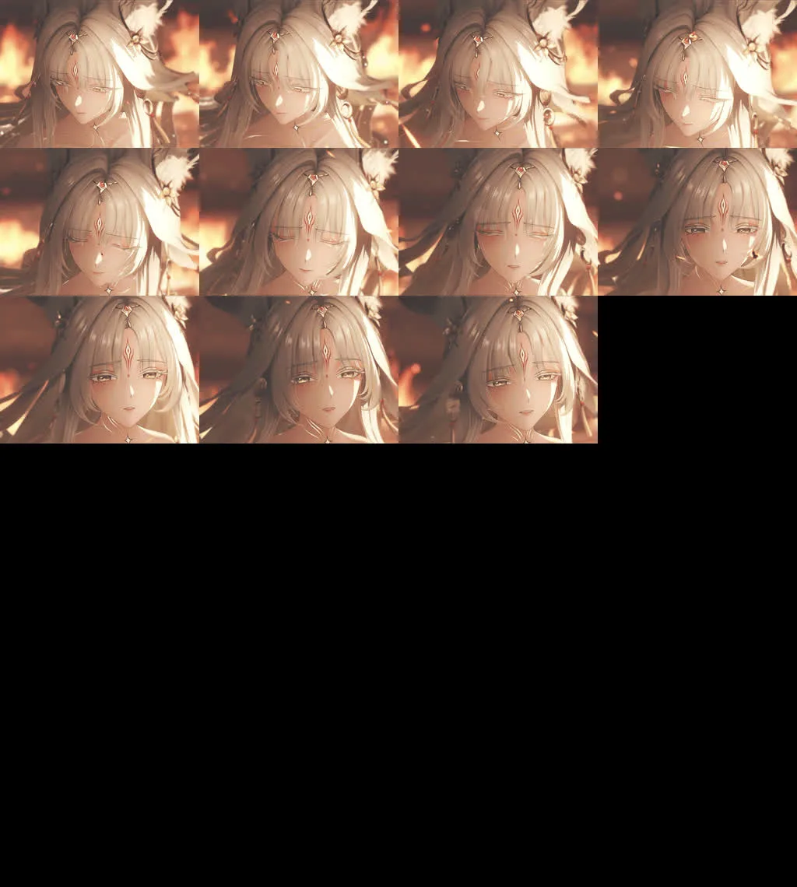

## wuthering-wave-hsin.gif

Duração do arquivo 1.900 s. Identificador hsin-9cdbfdf4cddb.

Personagem escura. olhos âmbar, cabelo escuro, sorriso/cabeça mudando no close. Identidade Hsin não comprovada nesta amostra. Excluir de morph/rig até identificação.

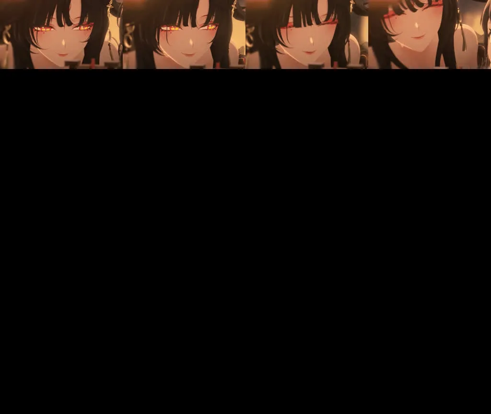

## wuthering-waves-wuwa.gif

Duração do arquivo 2.510 s. Identificador hsin-8a5397d4af26.

Close com ornamentos e pétalas. movimento de torso/cabeça sob sombra e elementos vermelhos; loop curto. Luz pulsante e enquadramento impedem inferência precisa da cinemática.

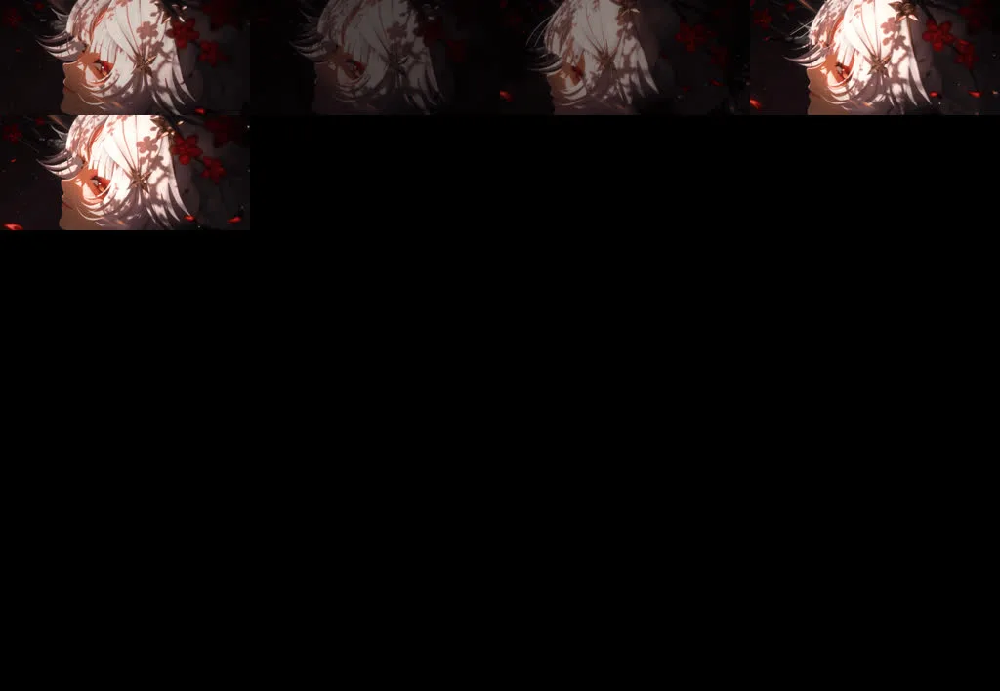

## wuwa-wuthering-waves.gif

Duração do arquivo 10.930 s. Identificador hsin-ea7e6cdb2f56.

Montagem narrativa e combate. rosto, mão, pilares, palma, corpo e closes alternados com outros personagens. Montagem com muitos cortes. Útil à direção artística, inadequada como ataque contínuo.

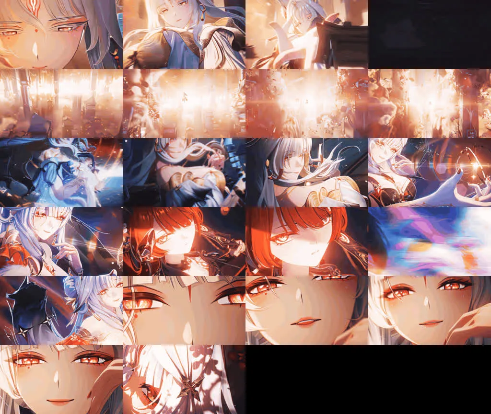
