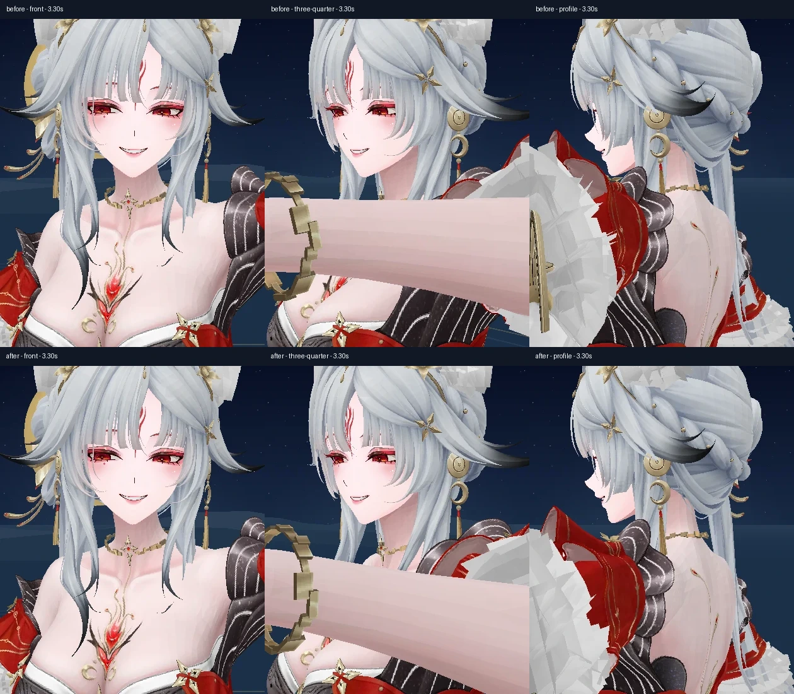
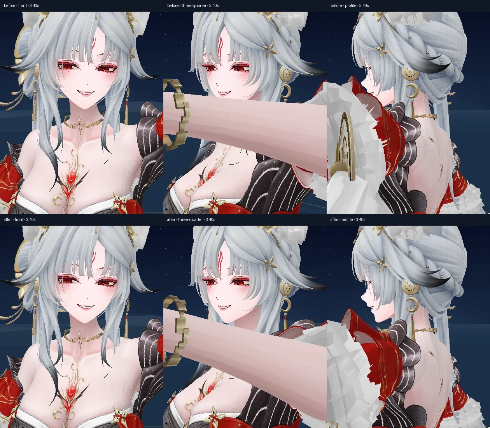
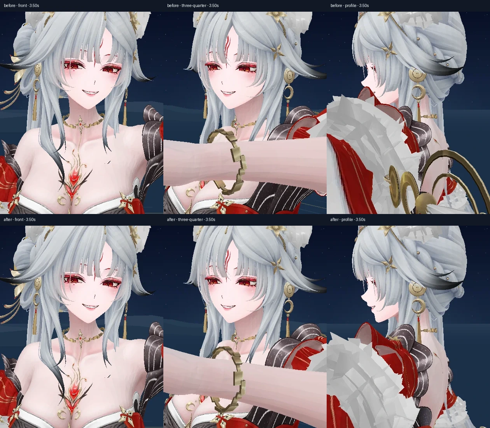

# Hsin Combat R2.1.1 · aceitação visual e ajuste localizado

Base auditada: PR #272, 8c4817288702b53c24eb5708e21200d49c03dd9a.

## Basic 02

Defeito reproduzido no GLB real em 3,3–3,5 s. A mão/antebraço esquerdo cruza a projeção da boca em ¾ e ocupa parte do perfil. A vista frontal permanece legível. As pranchas CPU abaixo mantêm lente, tempo e câmera iguais entre antes/depois.

A correção altera somente o vetor de plano do cotovelo em três intenções existentes do braço esquerdo, durante aproximação, ápice e acomodação. Os alvos de mão, as orientações de palma e os tempos foram preservados. O golpe continua ascendente, com os mesmos marcadores e duração. Nenhuma mudança de solver, limites, skin weights, morphs, câmera, VFX ou interface.

A razão trajetória/corda do Basic 02 permaneceu em 1,252 e a subida em 0,352 m, acima da subida de 0,226 m do Basic 01. O teste de atuação original passou sem relaxamento de critérios. As comparações não substituem a aprovação artística.

## Basic 01 e os 467 ms

A diferença de 466,7 ms usa a velocidade da mão relativa ao ombro e à orientação da coluna: pico em 1,733 s, marcador em 2,2 s. Em espaço mundial, o pico ocorre em 1,967 s, 233,3 ms antes do marcador. No impacto ainda há 0,594 m/s de velocidade mundial.

O marcador ocorre a 0,56 mm do máximo de alcance frontal medido, atingido em 2,233 s. A trajetória corresponde a uma varredura que desacelera ao chegar ao alcance final; não há parada de mão antes do impacto. A inspeção e essas medidas não estabeleceram defeito que justifique mudar o Basic 01. Seus canais e marcadores foram preservados.

trajectory-audit.json contém velocidades, posições, canais alterados e confirmação de posições de suporte e sequência inalteradas.

## Facial e QA temporal

As receitas existentes são mantidas. O harness de aceitação usa o binding, o ator facial com seed fixo e o mesmo mapa de pesos da R2.1 para capturar preparação, impacto, liberação e recuperação. Blink e morphs de repouso seguem o pipeline existente. Não foram aumentadas intensidades.

O antigo smoke WebGL aguardava time >= alvo e pausava por clique, produzindo instantes aproximados. O novo harness, restrito a scripts/qa e sem entrada no build público, aplica pose e eventos em relógio controlado, incluindo exatamente todos os marcadores, e renderiza sem RAF próprio. Essa instrumentação de QA não muda o sequenciador público. O runtime normal continua quantizando a apresentação ao frame; trajectory-audit.json registra os atrasos com passos de 30 Hz.

A infraestrutura local de preview encerrou o processo do Astro em background. Capturas novas em software WebGL são executadas no CI, com before.json fixado no commit-base e o GLB/material/luzes reais do harness existente. Seus resultados são evidência de imagem e sincronização, sem medição de GPU física.

## Integridade, testes e orçamento

- O gate anatômico R2.0.1 continua integralmente em vigor.
- GLB canônico, perfis, pesos de skin, contemplativos, Dança Lunar e Shorekeeper estão fora da correção.
- Pool de efeitos conservado: 7 meshes, 4 geometrias, 5 materiais e zero texturas/render targets novos.
- anatomy.json e acting.json registram os gates do mesmo solver e os testes originais.
- structural.json registra apoio, continuidade e a sessão determinística de 600 s.
- Interrupção, restart, pausa, retomada e descarte são revalidados pelo teste do laboratório e pela suíte de atuação.

O protocolo de GPU física está em gpu-protocol.md. Aprovação artística e dispositivo permanecem com o proprietário.
