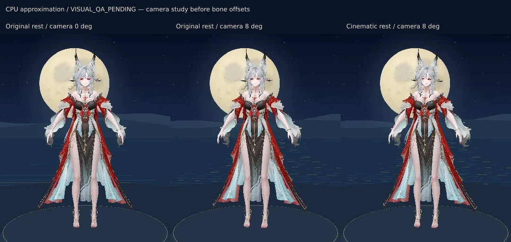
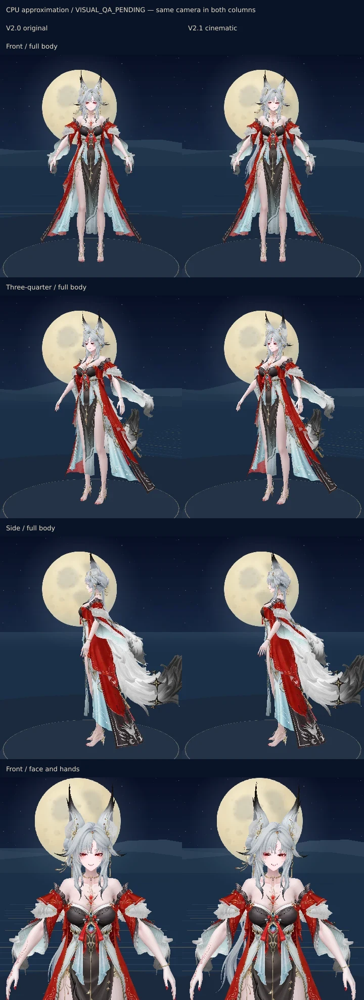

# Hsin V2.1 — referência corporal cinematográfica

**DRAFT / VISUAL_QA_PENDING.** A entrega muda a referência de repouso e o enquadramento inicial. Não cria episódios, não modifica os diretores e não altera o GLB ou o cenário. As comparações abaixo são rasterizações CPU do próprio GLB, não capturas WebGL nem aprovação artística.

## 1. Base auditada

- Repositório: `indiolibanes/portfolio`.
- Base inicial: `main` em `dbed434f9ee2f3249244fe5c7ea543eba34e48c5`, depois da integração do #168 e também do #169.
- Branch: `experiment/hsin-v21-cinematic-idle-2026-11-01`.
- O head e a prévia imutável ficam registrados no PR draft. Sem merge automático e sem alteração direta em `main`.
- Referência artística principal: Hsin central da imagem anexada como `1000054228.png` (Concerto Lunar das Raposas Celestiais). As demais imagens orientam identidade e atitude; proporções, materiais e anatomia continuam determinados pelo GLB.

Foi feita uma cópia independente do repositório porque o checkout transitório anterior havia perdido seu diretório Git. Dependências instaladas com o lockfile existente, sem novas dependências.

## 2. Repouso e escritores existentes

O GLB tem nove primitivas skinned, 823 bones e **zero AnimationClips**. As sequências existentes são atuação procedural com reprodução de quaternions pré-calculados. A exportação é quase simétrica, com braços afastados do tronco, cotovelos discretamente flexionados e mãos abaixo da cintura. O primeiro quadro V2.0 usava exatamente os quaternions exportados; o diretor iniciava em `rest` e aguardava a janela original de 5–9 segundos.

Todos os quaternions de repouso e os pais dos 823 bones estão em [hsin-v21-rest-audit.json](hsin-v21-rest-audit.json). `cinematicOverrides` nesse arquivo contém somente os 14 bones modificados; os demais mantêm `restQuaternions.original`. Os nomes são os que o GLTFLoader entrega, com pontos removidos: por exemplo, `ORG-Bip001Hand.R` do JSON do GLB vira `ORG-Bip001HandR` no player.

| Escritor | Bones/canais | Referência de retorno |
| --- | --- | --- |
| Assinatura direita | UpperArmR, ForearmR, HandR, pares ORG/DEF | `data.rest`, por restore exato; transição quíntica de 2,4 s preservada |
| Peito, composição e cabelo | UpperArmL, ForearmL, HandL, pares ORG/DEF | `data.rest`; variantes de peito compartilham o mesmo ator |
| Respiração de repouso | ORG-Bip001Spine2 | Quaternion capturado pelo construtor, restaurado antes de gestos |
| Atuação facial/olhar | Morph channels existentes; projeção do ponteiro no espaço da cabeça | Mesmos snapshots, limites, semente, política e calibração local |
| Nova referência | Dois heads e as seis articulações de cada braço | Aplicada uma vez antes de construir os atores; retirada integralmente após seu descarte |

`ORG-Bip001UpperArm* → Forearm* → Hand*` é uma cadeia contígua. Na cadeia DEF há intermediários `UpperArm*001` e `Forearm*001`. Copiar rotações locais indiscriminadamente entre as cadeias seria incorreto. As clavículas são ancestrais comuns dos braços; os heads ficam nas ramificações ORG/DEF Neck sob ORG-Spine2. Alterar o tronco ou as clavículas deslocaria os alvos mundiais das mãos.

Os solvers originais de assinatura/peito/cabelo usam referências mundiais de ombro, cabeça, olhos, tórax e cabelo durante o bake. O player público reproduz apenas os frames locais resultantes. O novo bake não refaz esses alvos nem roda IK. A projeção do olhar continua usando a matriz inversa da cabeça real; a calibração local é preservada.

## 3. Câmera antes de bones

Um estudo separado compara câmera 0°/repouso original, câmera 8°/repouso original e câmera 8°/novo repouso. O azimute de 8° fornece a pequena obliquidade do corpo sem mover ombros, pés ou trajetórias mundiais. Por isso **tronco, inclinação do torso, cervical e clavículas têm offset zero** nesta candidata. A assimetria dos ombros vem do enquadramento e da diferença entre os ajustes dos braços.



Altura, alvo, distância de enquadramento e limites orbitais continuam iguais. O novo azimute só é usado no primeiro enquadramento e no botão de retorno. Nenhum gesto move a câmera. A lua continua enquadrada pela mesma camada celeste do #168; não há alteração no cenário ou em seus materiais.

## 4. Offsets finais

Os graus abaixo são deltas da referência, não ângulos Euler absolutos. Eixos anatômicos são medidos com ombros, Spine2, Neck e a direção da face: up, lateral e forward. Cada eixo mundial é convertido para o espaço do pai do bone antes de formar o quaternion. Braços usam adução em direção ao torso, flexão do cotovelo em direção a forward e flexão discreta do punho.

| Bone | Ajuste anatômico | Magnitude local final aproximada |
| --- | --- | ---: |
| ORG-Bip001UpperArmR | Adução 1,5° | 1,500000° |
| DEF-Bip001UpperArmR | Delta mundial reconciliado ao ORG | 1,499991° |
| ORG-Bip001ForearmR | Flexão 4° | 4,000000° |
| DEF-Bip001ForearmR | Delta mundial reconciliado ao ORG | 4,000009° |
| ORG-Bip001HandR | Flexão 2° | 2,000000° |
| DEF-Bip001HandR | Delta mundial reconciliado ao ORG | 2,000000° |
| ORG-Bip001UpperArmL | Adução 2° | 2,000000° |
| DEF-Bip001UpperArmL | Delta mundial reconciliado ao ORG | 1,999999° |
| ORG-Bip001ForearmL | Flexão 6° | 6,000000° |
| DEF-Bip001ForearmL | Delta mundial reconciliado ao ORG | 6,000000° |
| ORG-Bip001HandL | Flexão 2° | 2,000000° |
| DEF-Bip001HandL | Delta mundial reconciliado ao ORG | 2,000000° |
| ORG-Bip001Head | Yaw +4° e roll −2° | 4,471954° combinados |
| DEF-Bip001Head | Mesmo delta mundial do head ORG | 4,471954° combinados |

Não há rotação ou translação nova em dedos, pernas, pés, quadril, spine, neck ou clavículas. A cabeça fica orientada um pouco mais para o observador e inclinada; seu ajuste é estático. O centro ocular mundial se desloca aproximadamente **5,80 mm**, consequência explicitamente medida da nova orientação. A relação visual entre mão e face ainda exige aceite humano.

## 5. Retargeting offline

`scripts/bake-hsin-cinematic-idle.mjs` lê o GLB e o perfil V2.0 sem modificá-los. Calcula a nova referência, transforma os frames iniciais e gera `hsin-v2.1-profile.json`, conservando `names/rest/frames/negative/positive`. O limite/erro do solver original continua identificado como validação do bake V2, sem ser apresentado como erro da nova referência.

Para cada driver ORG:

`q_new(t) = slerp(I, q_offset_parent, envelope(t)) * q_original(t)`

`q_offset_parent` é o delta anatômico expresso no espaço do pai, multiplicado à esquerda. O envelope vai de 1 a 0 entre pesos 0 e 0,375, usando smootherstep de grau 7, cujas três primeiras derivadas se anulam nos extremos. O corte coincide com a amostra 24 da grade original de 65 frames. O frame zero e `rest` recebem os mesmos valores exatos.

Para cada deformer, em ordem proximal → distal:

`D_world_new = O_world_new * inverse(O_world_original) * D_world_original`

`D_local_new = inverse(D_parent_world_new) * D_world_new`

Isso respeita os pais intermediários DEF, em vez de presumir que seus eixos locais coincidem com ORG. Os offsets não se acumulam: cada amostra parte novamente do repouso original, e o player recebe dados prontos. Não existe novo escritor no loop de renderização.

Da amostra 24 em diante, os arrays originais são copiados **sem qualquer alteração numérica**, incluindo respiração positiva/negativa do braço esquerdo. Assim, a aproximação final, sustentação e orientação final das mãos preservam o movimento original. Não se afirma que todo o trajeto permaneceu igual: os primeiros 37,5% do peso mudam para conectar o novo repouso ao gesto existente.

| Medida em 257 pesos por trajetória/variante | Resultado |
| --- | ---: |
| Maior deslocamento da mão direita em relação à V2.0 | 20,68 mm, na região inicial de referência |
| Maior deslocamento da esquerda | 29,73 mm, na região inicial de referência |
| Deslocamento de ambas as mãos a partir de peso 0,375 | 0 m nos testes |
| Maior distância ORG/DEF no punho | Menos de 0,0005 mm |
| Continuidade no corte de referência | Variação adicional de velocidade angular menor que 0,002 rad por unidade de peso |

A reprodução antiga por SLERP de 65 amostras é segmentada; não é matematicamente C1 em todos os seus nós. O teste mede o vetor de velocidade angular adicional no corte, em vez de declarar continuidade ideal inexistente. As leis temporais quínticas, durações e reversões dos atores permanecem intactas. Entrada/saída assentam com velocidade tendendo a zero; o teste também limita passos angulares. A respiração original é retirada antes do gesto como na V2.0, sem alterar sua amplitude, relógio ou alocações.

## 6. Ajuste e reversibilidade

Configuração: `HSIN_CINEMATIC_IDLE` em `src/scripts/hsin-cinematic-idle.mjs`.

- `enabled=false`: monta o perfil V2.0, azimute inicial 0° e posters V2.0; nenhum offset cinematográfico é aplicado.
- `cameraAzimuthDegrees`: independente do bake; deve permanecer dentro dos limites orbitais existentes.
- `head`, `arms`, `fadeEnd`: exigem executar novamente o bake e os testes. O player recusa uma definição que não corresponda ao perfil gerado.
- O bake recusa valores não finitos, offsets maiores que os limites conservadores e cortes fora da grade de 65 amostras.
- `proximalOffsets` fica em zero: alterar tronco/neck/clavículas exige uma nova calibração espacial, e o bake recusa essa alteração.

Na montagem, `createCinematicReference` confere o repouso do modelo, aplica os 14 deltas e só então os atores capturam suas referências. Ao sair, o diretor devolve os braços ao repouso cinematográfico, e a referência restaura os valores originais. Os testes verificam reversibilidade exata de quaternion, posição e escala dos **823 bones**.

## 7. Preservação e desempenho

Permanecem sem alteração: GLB, perfil V2.0, esqueleto, hierarquia, materiais, morph targets, atores de braço, máquina de estados, parâmetros de probabilidade/cooldown, política facial, rastreamento ocular, respiração, loop e cenário lunar.

| Orçamento | V2.0 → V2.1 |
| --- | --- |
| GLB | 9.873.744 bytes → igual, SHA-256 `63506b0b7a2369722e6429c3b16c5f48764ee01706d1272b4ffd69a45c5e0d2c` |
| Bones / primitivas | 823 / 9 → iguais |
| Morphs e draw calls | Iguais; nenhuma geometria ou material novo |
| Perfil de atuação | Cerca de 5 KiB extras sem compressão; diferença exata em `hsin-v21-validation.json` |
| Trabalho de reprodução por frame | Mesmo interpolador, mesmos seis bones por ator e mesmos números de amostras |
| Novas operações de postura por frame | Nenhuma; somente aplicação/restauração na montagem/descarte |
| Alocações Quaternion em 600 s | Mesma contagem nas duas versões; a respiração antiga já aloca, sem acréscimo desta etapa |
| Resolução e loop | 30 FPS de teto; mesmo DPR/teto de pixels, pausas e render sob demanda |
| Dependências | Nenhuma nova |

O teste de 600 s a 30 Hz compara estado, relógios, cooldowns, prioridades e canais faciais quadro a quadro com a V2.0, com a mesma semente. Assinatura, peito, composição e cabelo foram todos alcançados. O teste verifica exclusão entre atores esquerdos, pausa/visibilidade, retorno exato e alocações equivalentes. As contagens `actionSamplesAt1Hz` do relatório são amostras de estado a cada segundo, não número de episódios.

## 8. Comparações visuais

Os pares usam a mesma câmera para separar a mudança de pose da mudança de enquadramento. Todos foram produzidos a partir das malhas, skins e texturas reais. Não usam ImageGen nem geometria inventada. A rasterização CPU aproxima transparência, luz, fog e materiais; não reproduz normal maps ou PBR completo.



| Comparação | Conteúdo |
| --- | --- |
| [Assinatura direita](qa/hsin-v21/signature.webp) | Entrada, meio, sustentação e retorno |
| [Peito esquerdo](qa/hsin-v21/chest.webp) | Entrada, meio, sustentação e retorno |
| [Cabelo](qa/hsin-v21/hair.webp) | Entrada, meio, sustentação e retorno |
| [Composição](qa/hsin-v21/composition.webp) | Direita sustentada + trajetória esquerda; retorno de ambas |

A inspeção estática cobre rosto, mãos, manga, ombros, pescoço, cabelo e silhueta. Não aprova ausência contínua de interpenetração nem naturalidade do movimento. Manter **VISUAL_QA_PENDING** até conferir WebGL, pausa/retomada e os gestos no desktop/Samsung Internet.

## 9. Testes e falha herdada da base

- Base sem modificações: suíte Hsin com **29 arquivos aprovados e 1 falha**.
- V2.1: suíte completa com **30 arquivos aprovados e a mesma falha**; o novo teste de referência e ciclo de 600 s passa.
- Falha herdada: `hsin-lunar-fox-cameo.test.mjs`. O arquivo `public/assets/hsin-3d-calling-lunar-fox.webp` tem 14.981 bytes, mas o cabeçalho RIFF declara 18.382. O teste e o asset foram preservados; não há skip nem relaxamento da asserção.
- O workflow executa o teste V2.1 antes da etapa legada. Assim, seu resultado fica visível mesmo quando a falha anterior bloqueia o job agregado.
- Build Astro e verificação OG: aprovados localmente.
- UX: 97/100, mesmas três falhas anteriores de navegação.
- `hsin-v21-validation.json`: métricas numéricas; `hsin-v21-rest-audit.json`: referências de todos os bones e offsets aplicados.

## 10. Reprodução e arquivos

```sh
node scripts/bake-hsin-cinematic-idle.mjs
HSIN_WRITE_CINEMATIC_REPORT=1 node tests/hsin-cinematic-idle.test.mjs
node scripts/render-hsin-cinematic-qa.mjs
node scripts/render-hsin-poster.mjs public/assets/models/hsin/hsin-v2.0.glb public/assets/models/hsin/hsin-v2.1-poster.webp 800 1100 --profile=cinematic
node scripts/render-hsin-poster.mjs public/assets/models/hsin/hsin-v2.0.glb public/assets/models/hsin/hsin-v2.1-poster-landscape.webp 1280 720 --profile=cinematic
node --test tests/hsin-*.test.mjs
npm run build
npm run check:ux
```

- Player/configuração: `hsin-cinematic-idle.mjs`, `hsin-stage.ts`, `hsin-stage-config.mjs`.
- Dados: `public/assets/models/hsin/hsin-v2.1-profile.json`, manifesto `src/data/hsin-v21-pose.json`.
- Fallback: dois posters V2.1 e seleção por configuração na página Astro, com versão de cache derivada do perfil.
- Autoria offline: bake cinematográfico e scripts de rasterização/QA.
- Evidência: teste novo, workflow, relatórios e seis pranchas estáticas em `docs/qa/hsin-v21/`.

Limitações de aceite: postura deliberadamente contida; cabeça e punhos precisam de avaliação artística; trajetos iniciais foram retargetados e não devem ser descritos como integralmente idênticos; teste amostrado não é prova contínua de colisão; FPS/VRAM não foram medidos. O arquivo truncado da seção Música é uma pendência independente da base. Sem merge automático.
